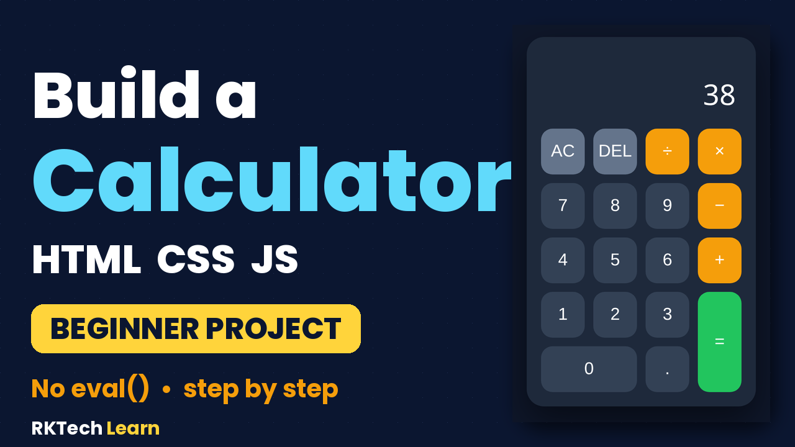

# Build a Calculator with HTML, CSS & JavaScript (Step by Step for Beginners)

**Video:** [Build a Calculator with HTML, CSS & JavaScript (Step by Step for Beginners)](https://youtu.be/FtO4V0Ihh1s)  
**Goes live:** Mon Nov 2, 2026, 7:00 PM PKT  
**Status:** Live



## What you build

A working calculator in the browser: a CSS Grid keypad, decimal numbers, AC and DEL, chained operations, divide-by-zero handling, a fix for the famous `0.1 + 0.2` rounding problem, and full keyboard support.

## Tech

HTML, CSS, and vanilla JavaScript (no libraries, no `eval()`)

## How to run it

Open `index.html` in your browser, or serve the folder:

```bash
npx --yes serve .
```

Then open the URL it prints (usually http://localhost:3000).

## Build steps (same order as the video)

1. **What we're building.** A four-function calculator with a live display, a history line, and both mouse and keyboard input. The finished file is just `index.html`, `style.css`, and `script.js`.
2. **The HTML.** Mark up the display and every key. Each button uses `data-action` (and `data-value` where needed) so one click listener can tell digits, operators, equals, AC and DEL apart.
3. **Style with CSS Grid.** Lay out the keypad with `grid-template-columns: repeat(4, 1fr)`. The `0` key spans two columns and the equals key spans two rows.
4. **State in variables.** Keep four pieces of state: `current` (the number being typed), `previous`, `operator`, and `resetNext`. One `update()` function redraws the screen from that state.
5. **Numbers and decimals.** `inputDigit()` appends a digit (replacing a leading zero). `inputDecimal()` adds a single `.` so you cannot type two dots.
6. **Operators without eval.** `calculate(a, b, op)` does one of the four sums and returns `null` for divide by zero. `evaluate()` runs `parseFloat` on the screen text first, then `format()` so `0.1 + 0.2` shows `0.3`.
7. **Clear, delete and clicks.** `clearAll()` resets state. `deleteLast()` removes the last character. One click listener on `.keys` uses event delegation and `closest("button")`.
8. **Keyboard support.** A `keydown` listener maps number keys, operators, Enter, Backspace and Escape onto the same functions as the buttons.
9. **Test the edge cases.** Check chained operations, divide by zero (shows Error), decimals, and keyboard input.

## Channel

This project is from [RKTech Learn](https://www.youtube.com/@rktech_learn), a YouTube channel that teaches coding to complete beginners.
