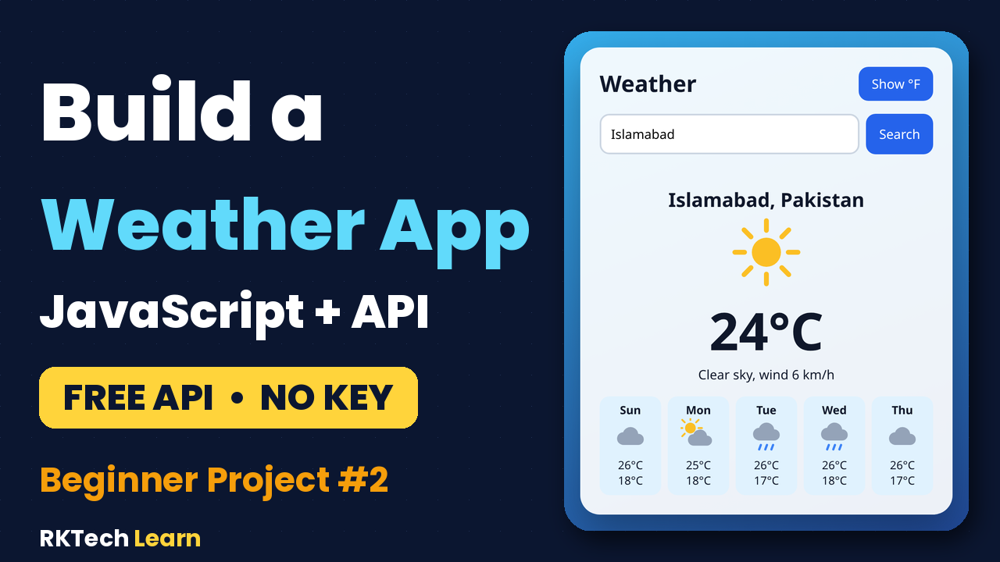

# Build a Weather App with JavaScript (Free API, No Key) | Beginner Project

**Video:** [Build a Weather App with JavaScript (Free API, No Key) | Beginner Project](https://youtu.be/tPBOTAvf3o8)  
**Goes live:** Wed Nov 4, 2026, 7:00 PM PKT  
**Status:** Live



## What you build

Type any city and see the current temperature, a weather icon, the wind, and a 5-day forecast. Includes loading and error states and a °C / °F toggle that re-renders saved data without calling the API again.

## Tech

HTML, CSS, vanilla JavaScript, `fetch` + `async`/`await`, the free Open-Meteo geocoding and forecast APIs (no API key)

## How to run it

Open `index.html` in your browser, or (recommended) serve the folder so requests behave like a real site:

```bash
npx --yes serve .
```

You need an internet connection. The app calls the public Open-Meteo APIs; no key or sign-up is required.

## Build steps (same order as the video)

1. **What we're building.** A search box, a current-conditions card, a 5-day forecast, and a unit toggle. Icons live in the `icons/` folder.
2. **The HTML.** A form with a city field, a status message, empty `#current` and `#forecast` areas, and a °C / °F button.
3. **Style it with CSS.** A simple, readable layout for the search form, the current card, and the forecast row.
4. **APIs and JSON.** Open-Meteo's geocoding API turns a city name into coordinates. The forecast API returns temperature, weather codes, and wind. Both are free and need no key.
5. **fetch, async and await.** `getJSON()` wraps `fetch`. It throws a clear error on a network failure and also when `res.ok` is false, because `fetch` does not throw on a 404 or 400.
6. **From city to weather.** `getCoords(city)` then `getWeather(lat, lon)` load the data. The result is saved in `lastData` so the unit toggle can re-render without a new request.
7. **Weather codes to icons.** `describe(code)` turns WMO numbers (0 is clear, 61 is rain, and so on) into an icon filename and a short label.
8. **Show the weather.** `render()` fills the current card and maps the daily forecast into HTML with template strings.
9. **Loading and error states.** A `try` / `catch` / `finally` around the request shows a loading message, then either the weather or a friendly error.
10. **The °C / °F toggle.** `formatTemp()` converts from the stored Celsius values. Clicking the button flips `unit` and calls `render()` if `lastData` is set.
11. **Test it.** Try a real city, a typo, and the unit toggle. Confirm a bad response is handled.
12. **Deploy on Vercel.** A static site like this can be dragged onto Vercel or deployed from a GitHub repo.

## Channel

This project is from [RKTech Learn](https://www.youtube.com/@rktech_learn), a YouTube channel that teaches coding to complete beginners.
