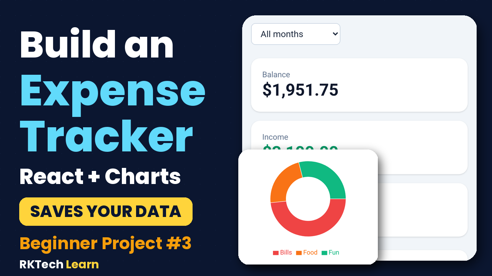

# Build an Expense Tracker in React (with Charts) | Beginner React Project

**Video:** [Build an Expense Tracker in React (with Charts) | Beginner React Project](https://youtu.be/fcZzCLGnQ78)  
**Goes live:** Fri Nov 6, 2026, 7:00 PM PKT  
**Status:** Live



## What you build

Add income and expenses with a category, see the balance update live, filter by month, and view a spending pie chart. Data survives a refresh because it is saved in `localStorage`. Amounts are converted with `Number()` so the total cannot become `"0510"`.

## Tech

React 19, Vite 8, Tailwind CSS 4, Recharts 3, `localStorage`

## How to run it

```bash
npm install
npm run dev
```

Then open the URL Vite prints (usually http://localhost:5173).

Other scripts: `npm run build` for a production build, `npm run preview` to preview it, `npm run lint` to lint with Oxlint.

## Build steps (same order as the video)

1. **What we're building.** A form, a live balance, a month filter, a transaction list, and a Recharts pie chart of spending by category.
2. **Create the project.** A Vite + React app (`package.json` scripts: `dev`, `build`, `lint`, `preview`).
3. **Tailwind CSS.** Tailwind 4 is wired through the `@tailwindcss/vite` plugin in `vite.config.js` and `src/index.css`.
4. **Plan the data.** Each transaction has an `id`, `type` (income or expense), `description`, numeric `amount`, `category`, and `date`.
5. **The form.** `TransactionForm` is a controlled form. On submit it runs `const value = Number(amount)` and rejects any amount that is not above 0.
6. **Add and delete.** `addTransaction` prepends a new item. `deleteTransaction` filters by `id`.
7. **A live balance.** `Summary` adds income and expenses separately so the balance stays correct.
8. **Filter by month.** A `<select>` filters the list by the `YYYY-MM` prefix of each date, or shows all months.
9. **The pie chart.** `SpendingChart` groups expenses by category with a totals object, then `Object.entries(...).map(...)` turns it into Recharts data.
10. **Save with localStorage.** `loadTransactions()` reads the saved list (or `[]`). `useState(loadTransactions)` lazy-initializes state. A `useEffect` writes the list back whenever it changes.
11. **Test it.** Add income and expenses, filter by month, refresh the page, and check the chart.
12. **Deploy on Vercel.** Build with `npm run build` and deploy the `dist` folder, or connect the repo to Vercel.

## Channel

This project is from [RKTech Learn](https://www.youtube.com/@rktech_learn), a YouTube channel that teaches coding to complete beginners.
