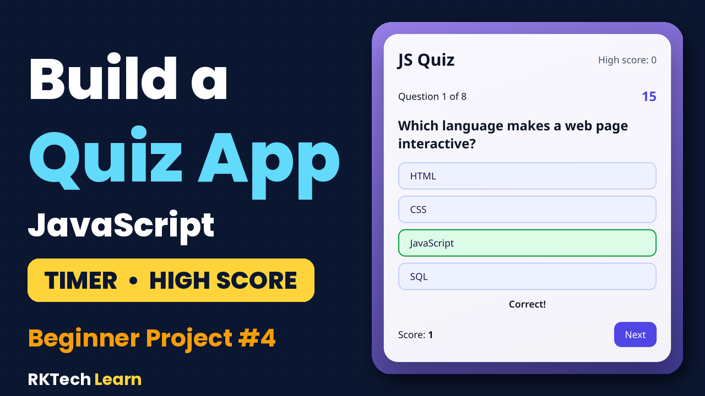

# Build a Quiz App with JavaScript (Timer, Score & High Score) | Beginner Project

**Video:** [Build a Quiz App with JavaScript (Timer, Score & High Score) | Beginner Project](https://youtu.be/_3ptzFDfqwc)  
**Goes live:** Mon Nov 9, 2026, 7:00 PM PKT  
**Status:** Live



## What you build

A multiple-choice quiz with questions stored as an array of objects. One question at a time, a 15-second timer, color-coded right and wrong answers, a locked set of buttons so you cannot score the same question twice, and a high score saved in `localStorage`.

## Tech

HTML, CSS, and vanilla JavaScript, `setInterval`, `localStorage`

## How to run it

Open `index.html` in your browser, or serve the folder:

```bash
npx --yes serve .
```

Questions live in `questions.js`. Edit that file to change or add questions.

## Build steps (same order as the video)

1. **What we're building.** Start, quiz, and end screens, a 15-second countdown, a running score, and a best-score message.
2. **The HTML.** Three screens in one page (`#start-screen`, `#quiz-screen`, `#end-screen`) plus slots for the question, answers, timer, and score.
3. **Style it with CSS.** Simple card layout, a timer that turns a warning color in the last five seconds, and `.correct` / `.wrong` styles for answers.
4. **Questions as data.** `questions.js` exports an array of objects: a question string, an `answers` array, and a `correct` index.
5. **Elements and state.** Cache the DOM nodes. State is `current`, `score`, `timeLeft`, `timerId`, and `highScore` (read from `localStorage`).
6. **Show a question.** `showQuestion()` fills the prompt, builds one button per answer, and starts the timer.
7. **Check the answer.** `selectAnswer(choice)` disables every answer button, marks the right and wrong ones, and updates the score. Disabling the buttons stops a double-click from adding points twice.
8. **The 15-second timer.** `startTimer()` calls `clearInterval(timerId)` first, then starts a new interval. If you skip `clearInterval`, old timers keep running and the countdown races. At 0 seconds it calls `selectAnswer(-1)` (time's up).
9. **Next question and the end.** The Next button moves on, or shows results on the last question.
10. **High score with localStorage.** `endQuiz()` compares the score to `quizHighScore` in `localStorage` and updates it when you beat it.
11. **Test it.** Try a correct answer, a wrong answer, running out of time, spam-clicking a button, and refreshing to see the high score.

## Channel

This project is from [RKTech Learn](https://www.youtube.com/@rktech_learn), a YouTube channel that teaches coding to complete beginners.
