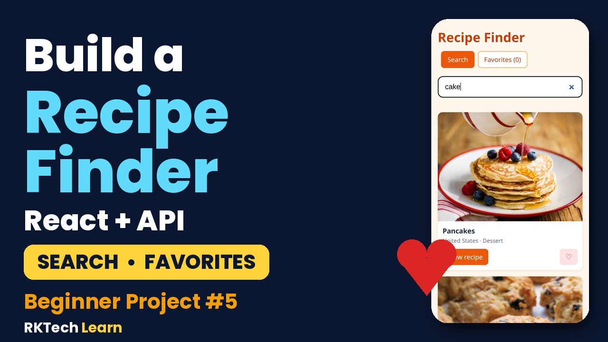

# Build a Recipe Finder App in React (Search API + Favorites) | Beginner Project

**Video:** [Build a Recipe Finder App in React (Search API + Favorites) | Beginner Project](https://youtu.be/Rv-gK8Cglt4)  
**Goes live:** Wed Nov 11, 2026, 7:00 PM PKT  
**Status:** Live



## What you build

Search meals by name, see results as cards, open a recipe with a clean ingredients list and steps, and save favorites. Search is debounced so typing does not fire a request on every key. Empty API results (`meals: null`) are turned into an empty array so `.map()` never crashes.

## Tech

React 19, Vite 8, `fetch` with `useEffect`, TheMealDB free API, `localStorage`

## How to run it

```bash
npm install
npm run dev
```

Then open the URL Vite prints (usually http://localhost:5173). You need an internet connection. The app uses TheMealDB's free public test endpoint (`/api/json/v1/1`); no key or sign-up is required.

Other scripts: `npm run build`, `npm run preview`, `npm run lint`.

## Build steps (same order as the video)

1. **What we're building.** A search tab and a favorites tab, a results grid, and a details panel with ingredients and instructions.
2. **Create the project.** A Vite + React app. Styling is plain CSS in `src/index.css`.
3. **The recipe API.** `src/api.js` talks to TheMealDB. `searchMeals()` returns `data.meals ?? []` so a `null` result (no matches) becomes an empty list. `getIngredients(meal)` loops `strIngredient1`…`strIngredient20` and skips empty fields.
4. **The search box.** `SearchBar` is a controlled input. The query lives in `App` state.
5. **Fetch with useEffect.** A `useEffect` calls `searchMeals` and uses an `AbortController` so an outdated request is cancelled.
6. **Debounce.** `useDebounce(query, 500)` waits until typing stops for 500 ms. The effect depends on `debouncedQuery`, not the raw input, so "chicken" sends one request instead of seven.
7. **Loading, empty, error.** The UI shows Loading…, a connection error, "type a meal name", or "no recipes found" depending on the state.
8. **Recipe cards.** `MealList` and `MealCard` render the results (or the favorites list).
9. **Recipe details.** `RecipeDetails` loads one meal with `getMeal`, lists ingredients from `getIngredients`, and shows the steps.
10. **Favorites + localStorage.** `useFavorites` keeps a list in state and writes it to `localStorage` so favorites survive a refresh.
11. **Test it.** Search, open a recipe, save a favorite, and try a query with no matches.
12. **Deploy on Vercel.** Build with `npm run build` and deploy the `dist` folder, or connect the repo to Vercel.

## Channel

This project is from [RKTech Learn](https://www.youtube.com/@rktech_learn), a YouTube channel that teaches coding to complete beginners.
