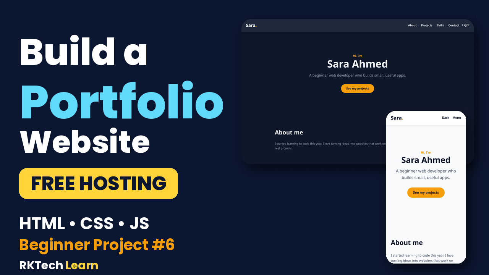

# Build a Personal Portfolio Website with HTML, CSS & JavaScript (Free Hosting) | Beginner Project

**Video:** [Build a Personal Portfolio Website with HTML, CSS & JavaScript (Free Hosting) | Beginner Project](https://youtu.be/DQO8V9FCxyw)  
**Goes live:** Fri Nov 13, 2026, 7:00 PM PKT  
**Status:** Live



## What you build

A one-page portfolio (the sample site is for "Sara Ahmed") with a hero, about, projects grid, skills, and footer. It has a mobile menu and a dark-mode toggle that is remembered in `localStorage`. The projects grid uses `repeat(auto-fit, minmax(240px, 1fr))` so it goes from three columns on a laptop to one on a phone with no media query.

## Tech

HTML, modern CSS (variables, flexbox, grid, `auto-fit`), and a little vanilla JavaScript

## How to run it

Open `index.html` in your browser, or serve the folder:

```bash
npx --yes serve .
```

Edit the name, projects, and links in `index.html` to make it your own. The sample content is fictional.

## Build steps (same order as the video)

1. **What we're building.** A responsive one-page site with navigation, a hero, sections, a projects grid, skills, and a footer.
2. **The HTML.** Semantic sections and a nav. Project cards live in a `.grid` container.
3. **CSS variables.** Colors, backgrounds, and text are variables on `:root`, with a `.dark` class on `body` that swaps them for dark mode.
4. **The navigation bar.** A simple header with links and a theme button. On small screens a Menu button toggles the nav.
5. **Hero and sections.** A hero headline plus About, Projects, Skills, and contact/footer sections.
6. **The projects grid.** `.grid { display: grid; grid-template-columns: repeat(auto-fit, minmax(240px, 1fr)); }` packs as many 240 px columns as will fit.
7. **Skills and footer.** A skills list and a footer whose year is filled in with JavaScript so it stays current.
8. **Make it work on phones.** Layout and typography adjust for narrow screens. The grid collapses on its own thanks to `auto-fit`.
9. **The phone menu.** `script.js` toggles an `.open` class, updates `aria-expanded`, and closes the menu when you tap a link.
10. **Dark mode.** `setTheme()` toggles the `.dark` class, updates the button label, and saves the choice with `localStorage.setItem("theme", theme)`. On load it reads that value, or defaults to light.
11. **Test it.** Resize the window, open the phone menu, toggle dark mode, and refresh to confirm the theme is remembered.
12. **Publish it for free.** The video walks through publishing a static site for free (GitHub Pages or a similar host) so you can link it on a CV.

## Channel

This project is from [RKTech Learn](https://www.youtube.com/@rktech_learn), a YouTube channel that teaches coding to complete beginners.
