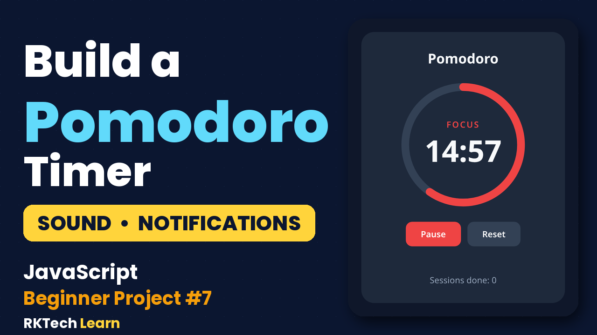

# Build a Pomodoro Timer with JavaScript (Start, Pause, Sound & Notifications) | Beginner Project

**Video:** [Build a Pomodoro Timer with JavaScript (Start, Pause, Sound & Notifications) | Beginner Project](https://youtu.be/9no6G4yB_Tw)  
**Goes live:** Mon Nov 16, 2026, 7:00 PM PKT  
**Status:** Live



## What you build

A 25-minute focus timer and a 5-minute break, with start, pause, and reset, a circular progress ring, a session counter, a bell sound, and a browser notification when time is up. The remaining time is computed from `endTime - Date.now()`, so a background tab cannot make the clock fall behind.

## Tech

HTML, CSS, vanilla JavaScript, `Date.now()`, `setInterval`, the Web Audio API (`bell.wav`), and the Notification API

## How to run it

Open `index.html` in your browser, or serve the folder:

```bash
npx --yes serve .
```

`bell.wav` is the session-end sound used in the video. Some browsers block sound or notifications until you click Start (the app requests notification permission on that click).

## Build steps (same order as the video)

1. **What we're building.** A focus/break timer with a ring, start/pause/reset, a session count, a sound, and a desktop notification.
2. **The HTML.** The time label, mode label, ring SVG, buttons, message, and session count.
3. **Style it with CSS.** A centered card and a circular progress ring whose stroke is updated from JavaScript.
4. **Variables and state.** `mode`, `duration`, `remaining`, `endTime`, `timerId`, and `sessions`. Durations are stored in milliseconds.
5. **Draw it: render().** `render()` writes the clock, the document title, the ring offset, the Start/Pause label, and the session count.
6. **Count with Date, not ticks.** `start()` sets `endTime = Date.now() + remaining` and runs `tick()` every 250 ms. `tick()` sets `remaining = Math.max(0, endTime - Date.now())`. Counting ticks (`remaining -= 250`) would drift when the tab is in the background.
7. **Start, pause and reset.** Pause clears the interval and stores the leftover time. Reset puts the current mode back to its full duration.
8. **Time's up: sound and notification.** `finish()` plays `bell.wav`, shows a notification if permission was granted, increments sessions after a focus block, and switches to the other mode.
9. **Test it.** Start, pause, reset, and let a short test duration finish to hear the bell and see the notification.

## Channel

This project is from [RKTech Learn](https://www.youtube.com/@rktech_learn), a YouTube channel that teaches coding to complete beginners.
