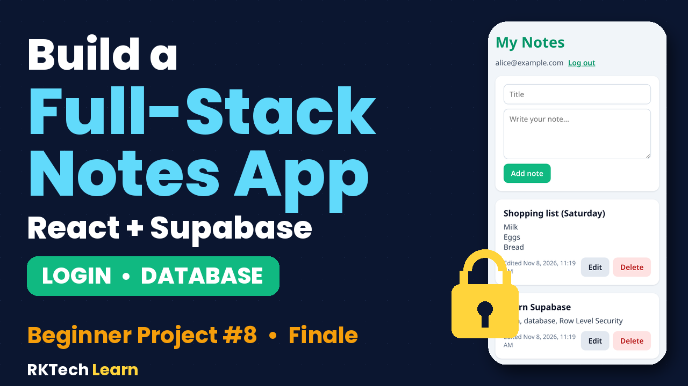

# Build a Full-Stack Notes App with React + Supabase (Login & Database) | Beginner Project

**Video:** [Build a Full-Stack Notes App with React + Supabase (Login & Database) | Beginner Project](https://youtu.be/lme8CzPdWd4)  
**Goes live:** Wed Nov 18, 2026, 7:00 PM PKT  
**Status:** Live



## What you build

Sign up and log in, then create, edit, and delete notes that live in a real Postgres database. Row Level Security means each user only sees their own notes. There is no custom server — Supabase is the backend.

## Tech

React 19, Vite 8, Supabase (Postgres, email login, Row Level Security) via `@supabase/supabase-js`

## How to run it

1. Create a free project at [supabase.com](https://supabase.com).
2. In the SQL Editor, paste and run `supabase/schema.sql`. This creates the `notes` table and the Row Level Security policies.
3. Copy the env file and paste your Project URL and publishable (anon) key from the Supabase dashboard (Project Settings → API):

```bash
cp .env.example .env.local
```

4. Install and start the app:

```bash
npm install
npm run dev
```

Then open the URL Vite prints (usually http://localhost:5173).

`.env.local` is gitignored. Never commit a real key. The publishable/anon key is safe to use in a browser app, but the `service_role` key is not — this project never uses it.

Other scripts: `npm run build`, `npm run preview`, `npm run lint`.

## Build steps (same order as the video)

1. **What we're building.** An auth screen and a notes list with add, edit, and delete, all backed by Supabase.
2. **Create a Supabase project.** A new project in the Supabase dashboard gives you a URL and a publishable key.
3. **Create the React app.** A Vite + React app. `src/lib/supabaseClient.js` calls `createClient` with `import.meta.env.VITE_SUPABASE_URL` and `VITE_SUPABASE_PUBLISHABLE_KEY`.
4. **The notes table.** `supabase/schema.sql` creates `public.notes` with `id`, `user_id`, `title`, `content`, and timestamps.
5. **Row Level Security.** The same SQL file turns RLS on and adds policies so a logged-in user can only read, insert, update, and delete rows where `user_id` is `auth.uid()`.
6. **Connect React to Supabase.** Copy `.env.example` to `.env.local` and paste your URL and publishable key.
7. **Sign up and log in.** `Auth.jsx` calls `supabase.auth.signUp` or `signInWithPassword` with email and password.
8. **Remember the session.** `App.jsx` reads `supabase.auth.getSession()` on load and subscribes to `onAuthStateChange`, so a refresh keeps you logged in.
9. **Load and add notes.** `Notes.jsx` selects rows from `notes` and inserts a new row. RLS attaches `user_id` for you.
10. **Edit and delete.** Update and delete go through Supabase, scoped to your own rows by the policies.
11. **Test it.** Sign up, add a note, refresh, edit, delete, and (if you can) confirm a second account cannot see the first account's notes.
12. **Deploy on Vercel.** Set the same `VITE_SUPABASE_*` variables in the Vercel project, build, and deploy. Add your production URL to the Supabase auth redirect allow-list.

## Channel

This project is from [RKTech Learn](https://www.youtube.com/@rktech_learn), a YouTube channel that teaches coding to complete beginners.
