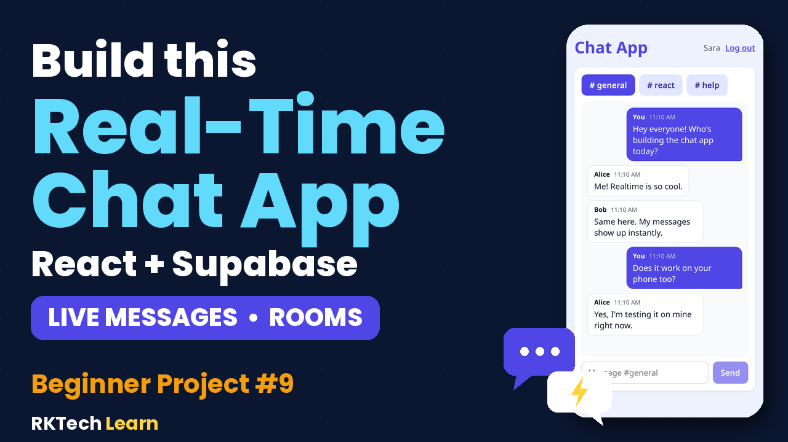

# Build This Real-Time Chat App with React + Supabase (Live Messages & Rooms) | Beginner Project

**Video:** [Build This Real-Time Chat App with React + Supabase (Live Messages & Rooms) | Beginner Project](https://youtu.be/xvqYZGNVFJE)  
**Goes live:** Fri Nov 20, 2026, 7:00 PM PKT  
**Status:** Scheduled



## What you build

Log in, pick a room (general, react, or help), and chat live. New messages appear on everyone's screen instantly through Supabase Realtime. History is loaded from Postgres; RLS lets logged-in users read the room and only send messages as themselves.

## Tech

React 19, Vite 8, Supabase (Postgres, email login, Row Level Security, Realtime) via `@supabase/supabase-js`

## How to run it

1. Create a free project at [supabase.com](https://supabase.com).
2. In the SQL Editor, paste and run `supabase/schema.sql`. This creates the `messages` table, the RLS policies, and adds the table to the Realtime publication.
3. In the Supabase dashboard, make sure Realtime is enabled for the `messages` table (the SQL file already runs `alter publication supabase_realtime add table public.messages`).
4. Copy the env file and paste your Project URL and publishable (anon) key:

```bash
cp .env.example .env.local
```

5. Install and start the app:

```bash
npm install
npm run dev
```

Then open the URL Vite prints (usually http://localhost:5173). Open a second browser (or a private window), sign in as another user, and you should see messages appear live.

`.env.local` is gitignored. Never commit a real key, and never use the `service_role` key in this app.

Other scripts: `npm run build`, `npm run preview`, `npm run lint`.

## Build steps (same order as the video)

1. **What we're building.** Email login, three chat rooms, message history, live incoming messages, and bubbles that auto-scroll.
2. **Your Supabase project.** Create a project and copy the URL and publishable key into `.env.local`.
3. **Create the React app.** A Vite + React app. `src/lib/supabaseClient.js` creates the client from env vars, the same pattern as the notes app.
4. **The messages table.** `supabase/schema.sql` creates `public.messages` with `room`, `user_id`, `username`, `content`, and `created_at`.
5. **Row Level Security.** Logged-in users can read every message. Inserts are allowed only when `user_id` is `auth.uid()`.
6. **Turn on Realtime.** The schema adds `messages` to the `supabase_realtime` publication so clients can subscribe to inserts.
7. **Connect and log in.** `Auth.jsx` signs up or signs in. `App.jsx` keeps the session with `getSession` and `onAuthStateChange`.
8. **Chat rooms.** Rooms are `general`, `react`, and `help` — the same values the table's check constraint allows.
9. **Load the history.** `ChatRoom.jsx` selects existing rows for the current room, ordered by time.
10. **Listen for new messages.** A Realtime channel listens for `INSERT` on `messages` in that room and appends each new row to the list.
11. **Send a message.** The form inserts `{ room, username, content }` (and `user_id` comes from the session).
12. **Bubbles and auto-scroll.** `Message.jsx` styles your own messages differently. The list scrolls to the latest message.
13. **Test it.** Open two sessions, send messages in the same room, and confirm they appear live. Check that a blank or oversized message is rejected.
14. **Deploy on Vercel.** Set the `VITE_SUPABASE_*` env vars in Vercel, deploy, and allow your production URL in Supabase Auth.

## Channel

This project is from [RKTech Learn](https://www.youtube.com/@rktech_learn), a YouTube channel that teaches coding to complete beginners.
