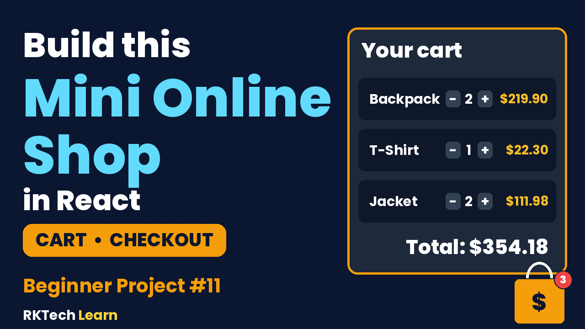

# Build This Mini Online Shop in React (Cart, Checkout & Router) | Beginner Project

**Video:** [Build This Mini Online Shop in React (Cart, Checkout & Router) | Beginner Project](https://youtu.be/vkyazsWoGRY)  
**Goes live:** Wed Nov 25, 2026, 7:00 PM PKT  
**Status:** Scheduled



## What you build

MiniShop lists products, shows a details page, and has a cart and a checkout flow. The cart is a `useReducer` store shared through Context (add, change quantity, remove, clear). The header badge stays in sync on every page.

## Tech

React 19, Vite 8, React Router 8, `useReducer` + Context, the free Fake Store API (no key)

## How to run it

```bash
npm install
npm run dev
```

Then open the URL Vite prints (usually http://localhost:5173). You need an internet connection. Products come from `https://fakestoreapi.com`; no API key is required.

Other scripts: `npm run build`, `npm run preview`, `npm run lint`.

## Build steps (same order as the video)

1. **What we're building.** A shop home, a product page, a cart, and a checkout page, with a cart badge in the header.
2. **Create the app.** A Vite + React app with `react-router`.
3. **Routes.** `App.jsx` nests home, `product/:id`, `cart`, `checkout`, and `*` under a layout route. `main.jsx` wraps the tree in the cart provider and `BrowserRouter`.
4. **Fetch the products.** `src/api.js` uses the Fake Store API. `getProduct` treats an empty body as `null` for an unknown id.
5. **The cart reducer.** `cartReducer.js` handles add, set quantity, remove, and clear. Quantities drop off the cart when they go below 1.
6. **Share the cart with Context.** `CartProvider` holds `useReducer` and exposes the cart plus dispatch helpers through `CartContext`.
7. **Layout + cart badge.** `Layout.jsx` reads the cart count so the badge updates on every page.
8. **The shop page.** `Home.jsx` lists products as cards with an Add button.
9. **The product page.** `ProductDetails.jsx` loads one product and can add it to the cart.
10. **The cart page.** `Cart.jsx` lets you change quantities or remove items and shows the total.
11. **Checkout.** `Checkout.jsx` collects a name and address (the form is a front-end demo; there is no real payment) and can clear the cart.
12. **Test it.** Add items from home and from a product page, change quantities, check out, and visit a bad product URL.
13. **Deploy on Vercel.** `vercel.json` rewrites all paths to `index.html`. Build with `npm run build` and deploy.

## Channel

This project is from [RKTech Learn](https://www.youtube.com/@rktech_learn), a YouTube channel that teaches coding to complete beginners.
