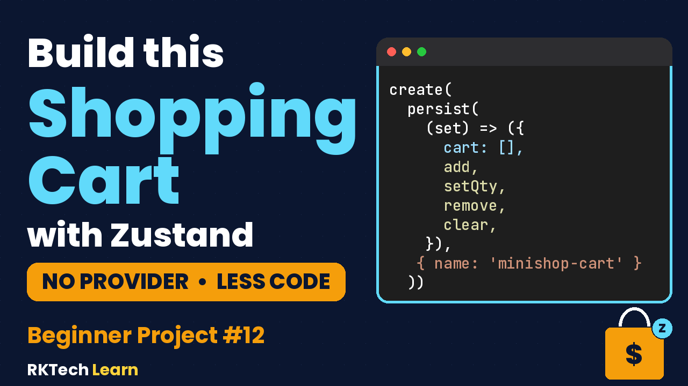

# Build This Shopping Cart with Zustand in React (Store, Selectors & Saved Cart) | Beginner Project

**Video:** [Build This Shopping Cart with Zustand in React (Store, Selectors & Saved Cart) | Beginner Project](https://youtu.be/W8EY__yGdrE)  
**Goes live:** Fri Nov 27, 2026, 7:00 PM PKT  
**Status:** Scheduled



## What you build

The same MiniShop, but the Context + `useReducer` cart is replaced with a Zustand store. Selectors keep components from re-rendering too often, and `persist` saves the cart to `localStorage` under `minishop-cart` so it survives a refresh.

## Tech

React 19, Vite 8, React Router 8, Zustand 5 with the `persist` middleware, Fake Store API

## How to run it

```bash
npm install
npm run dev
```

Then open the URL Vite prints (usually http://localhost:5173). You need an internet connection for the Fake Store API. The cart is saved in the browser; clear site data if you want a fresh cart.

This project starts from the Mini Shop in `projects/advanced-react/03-mini-shop`. The pages look the same; the difference is `src/cart/useCartStore.js`.

Other scripts: `npm run build`, `npm run preview`, `npm run lint`.

## Build steps (same order as the video)

1. **What we're changing.** Drop `CartContext` and `cartReducer`. Every page that used the context now calls the Zustand store.
2. **Install Zustand.** `zustand` is in `package.json` (this project uses ^5.1.0).
3. **Create the store.** `useCartStore.js` calls `create(...)` with `add`, `setQty`, `remove`, and `clear`. Updates always return a new `cart` array.
4. **Save it with persist.** Wrap the store in `persist(..., { name: "minishop-cart" })` so Zustand writes it to `localStorage`.
5. **Selectors.** `selectCount` and `selectTotal` pick one derived value. Pages subscribe with `useCartStore(selectCount)` instead of the whole store.
6. **Use it on every page.** The layout badge, product Add button, cart page, and checkout all read or update the same store. There is no provider to wrap.
7. **The selector trap.** If a component selects a new object or array on every call, it will re-render every time. Select a primitive, or a stable selector like `selectCount`.
8. **Context or Zustand?.** Context + `useReducer` is built in and fine for a small tree. Zustand is nicer when many pages need the same store and you want persistence without extra code.
9. **Test it.** Add items, refresh the page (the cart should still be there), change quantities, and check the header badge.

## Channel

This project is from [RKTech Learn](https://www.youtube.com/@rktech_learn), a YouTube channel that teaches coding to complete beginners.
