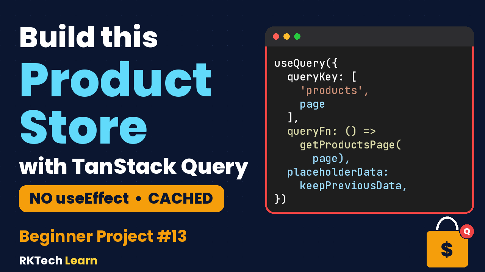

# Build This Product Store with TanStack Query (Caching, Pagination & Mutations) | Beginner Project

**Video:** [Build This Product Store with TanStack Query (Caching, Pagination & Mutations) | Beginner Project](https://youtu.be/ap-io74gk3g)  
**Goes live:** Mon Nov 30, 2026, 7:00 PM PKT  
**Status:** Scheduled



## What you build

The MiniShop data-fetching moves from `useEffect` to TanStack Query. The home page paginates with the page in the URL and `keepPreviousData`, product pages share a cache, a wishlist uses `useMutation` + `invalidateQueries`, and failed requests retry automatically. The cart is still the Zustand store from the previous video.

## Tech

React 19, Vite 8, React Router 8, Zustand 5, TanStack Query 5 (and React Query DevTools), Fake Store API

## How to run it

```bash
npm install
npm run dev
```

Then open the URL Vite prints (usually http://localhost:5173). You need an internet connection for the Fake Store API. Open the React Query DevTools panel (the floating icon) to watch the cache, stale times, and retries.

The wishlist is stored in `localStorage` behind a small async helper in `src/wishlist/`, so you can see mutations without a real backend.

Other scripts: `npm run build`, `npm run preview`, `npm run lint`.

## Build steps (same order as the video)

1. **What we're changing.** Product loading leaves `useEffect`. The cart stays in Zustand. A new wishlist page is added.
2. **Install and set up.** `main.jsx` creates a `QueryClient` with `staleTime: 30_000` (30 seconds) and wraps the app in `QueryClientProvider`, plus `<ReactQueryDevtools />`.
3. **useQuery on the home page.** `Home.jsx` uses `useQuery({ queryKey: ['products', page], queryFn, placeholderData: keepPreviousData })`. The page number lives in the URL. Fake Store has no `?page=`, so the code fetches a list and slices it.
4. **The product page.** `ProductDetails.jsx` uses `useQuery({ queryKey: ['product', id], ... })` instead of a `useEffect` with an ignore flag.
5. **Caching and staleTime.** Going back to a page you just visited can reuse the cache. With a 30-second `staleTime`, fresh data is not refetched right away.
6. **Refetch on window focus.** After data goes stale, focusing the window triggers a refetch. While it is still fresh, focus does not hit the API again.
7. **Pagination.** Pager buttons update the `page` search param. `keepPreviousData` keeps the old page on screen until the next one arrives.
8. **Mutations: a wishlist.** `useWishlist` loads the list with `useQuery` and changes it with `useMutation`. On success it calls `invalidateQueries` so the badge and page stay in sync. `wishlistApi.js` is a pretend async server on top of `localStorage`.
9. **Errors and retries.** TanStack Query retries failed requests (1 s, 2 s, 4 s, …) before showing the error.
10. **DevTools.** The React Query DevTools let you inspect queries, mutations, and the cache while you click around.
11. **Test it.** Page through products, open a product twice (the second visit should be cached), add a wishlist item, and use the DevTools to watch refetches.

## Channel

This project is from [RKTech Learn](https://www.youtube.com/@rktech_learn), a YouTube channel that teaches coding to complete beginners.
